# 9. Technical Architecture — How a Risk Becomes a Resolved Issue

This section describes the **minimum logical architecture required by the owner-confirmed workflow**. The feature owner confirms the end-to-end operation, but has not supplied a Friday Twin implementation diagram, service inventory, or run trace. Do not present a particular database, model, queue, vector index, or cloud topology as a Friday deployment fact.

## Architecture overview

```mermaid
flowchart LR
  A[Authorized group messages, minutes, documents] --> B[Timed source scan and current-state read]
  B --> C[Relevant history and Memory retrieval]
  C --> D[AI: commitment, project risk, people, resolution path, acceptance standard]
  D --> E[Permission and privacy decision]
  E -->|Allowed| F[Contact contributor and lead]
  E -->|Needs confirmation| G[User approval]
  G --> F
  F --> H[Delivery result and issue state]
  H --> I[Later replies, artifacts, task status]
  I --> J[Verify against acceptance standard]
  J -->|Not met| D
  J -->|Met| K[Evidence-backed resolution]
```

**Input → Context Retrieval → Memory → Model/Agent → Tool Selection → Action → Verification → Output:** The diagram shows the logical flow. “Memory” is supporting context, while live source reads and action receipts establish current state.

## Major components and why they matter

| Component | Job and necessity | Failure if absent | Alternative / decision status |
|---|---|---|---|
| Connector and scope layer | Read only authorized groups, minutes, and documents; carry account and source identity. | Friday might miss the work or combine unrelated identities. | Friday Onboarding PRD specifies connector-account separation; actual risk-workflow integration inventory not supplied. |
| Scheduled observation | Revisit ordinary authorized group messages without waiting for an @ mention. | No proactive discovery. | Feature owner confirms fixed-time scanning; exact schedule is intentionally not a customer claim. |
| Context retrieval | Find the original promise, newer corrections, related participants, and expected artifact. | A reminder can be stale or go to the wrong person. | Search alone is insufficient; exact retrieval stack not supplied. |
| Memory / durable work state | Preserve the issue, source links, due time, owners, and prior outreach across scans. | Every check begins from zero or duplicates work. | The underlying work-tracking baseline has project/TODO/follow-up state; Friday storage mapping not supplied. |
| Model/agent decision | Infer material risk, contributor vs. lead, possible resolution, and acceptance standard from unstructured context. | Fixed rules over-alert or miss changed plans. | Keyword-only routing is explicitly rejected in the underlying work-tracking Skill; model choice not supplied. |
| Action and permission gate | Decide whether a group reminder or lead notice is permitted and whether user confirmation is required. | Sensitive or misaddressed content could be sent. | Feature owner confirms conditional confirmation by safety/privacy boundary; exact gate implementation not supplied. |
| Channel tools | Deliver a message to the verified target and collect a result. | A generated draft could be mistaken for a sent message. | Underlying logic requires execution and read-back; Friday tool details not supplied. |
| Verification and audit | Compare later evidence with acceptance standard, retain action/result record, and suppress stale reminders. | False closure and repeated nudges. | Underlying work-tracking rules specify current evidence; Friday run evidence not supplied. |

A knowledge graph, vector database, and dedicated workflow engine may or may not be used. They are **not established facts** for this feature. The necessary product behavior is the lifecycle above, not a particular stack.

## Previous versus current architecture

The older Friday Task page PRD specifies an unimplemented, narrower personal Task view whose completion would be marked manually. The feature owner confirms the broader risk-to-resolution workflow runs. These are different product surfaces, so a technical “previous vs. current” migration cannot be reconstructed from the documents. Latency, retrieval accuracy, task success, cost per request, failure rate, and context capacity for either architecture are all **Not available yet**. Do not calculate an improvement from different scopes.

| Metric | Previous | Current | Improvement |
|---|---|---|---|
| Latency | Not measured | Not measured | Not calculable |
| Retrieval accuracy | Not measured | Not measured | Not calculable |
| Task / risk success | Not measured | Not measured | Not calculable |
| Cost per request | Not measured | Not measured | Not calculable |
| Failure rate | Not measured | Not measured | Not calculable |
| Context capacity | Not measured | Not measured | Not calculable |

## Required request trace

**Illustrative trace, not a captured run:** (1) Group message: Maya promises a compliance document by Thursday. (2) Retrieval: meeting minutes identify the promise and Alex as project lead; later group history shows no changed date. (3) Memory: prior project context links the document to launch readiness, but is not used as current completion proof. (4) Reasoning: the missing deliverable threatens a dependency; Friday derives “approved compliance document present in the agreed location or an accepted alternative” as the standard. (5) Tool selection: read the permitted document location; choose group reminder and lead notice. (6) External action: send only if permitted or after required confirmation. (7) Verification: collect send results, later recheck replies and the artifact, and leave open until the standard is met. (8) Output: a source-linked risk and eventual resolved/open status.

**Real trace, actual tool names, latency, model cost, and receipts:** **Not available yet — owner: product/engineering team — material required: one redacted production or controlled live run with timestamps and source links.**

**Sources:** Feature-owner answers (2026-09-24); [Friday Onboarding PRD](../../doc/feature0-onboarding%20page/00-Onboarding%20PRD.md); [underlying product logic](/Users/stardust/ceo/docs/product-logic.md); [underlying work-tracking rules](/Users/stardust/ceo/skills/ceo-work-tracking/SKILL.md).
